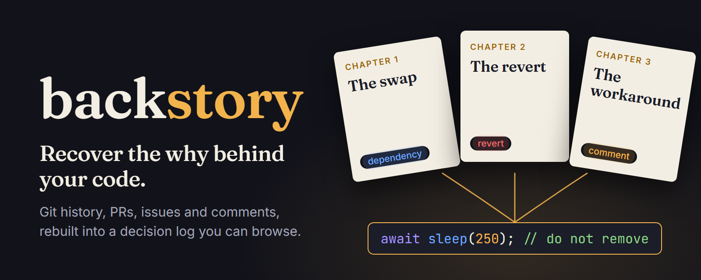
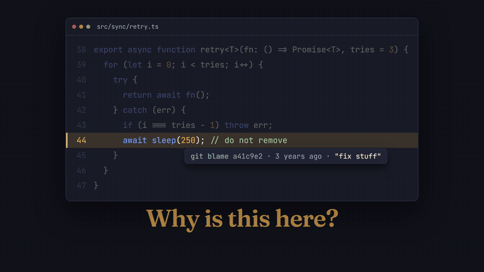
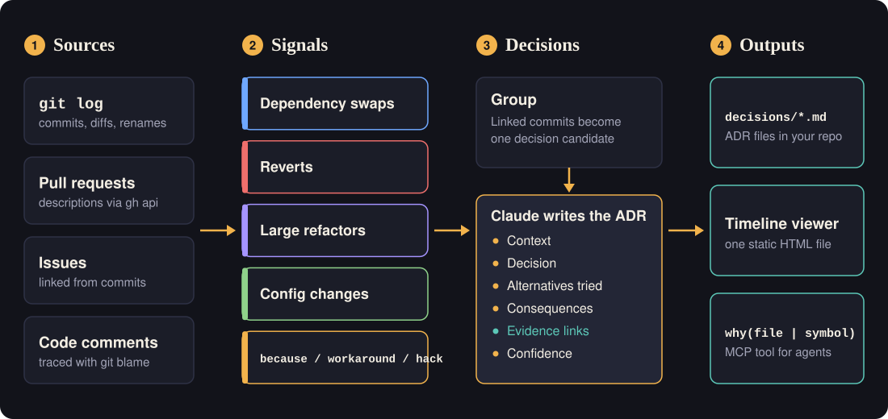
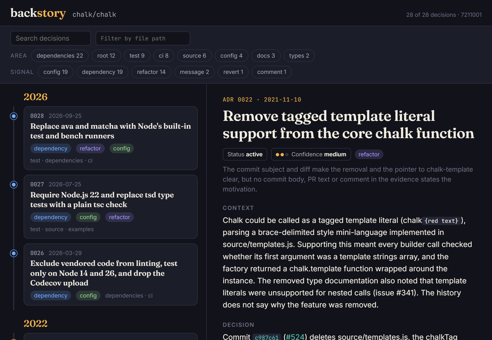
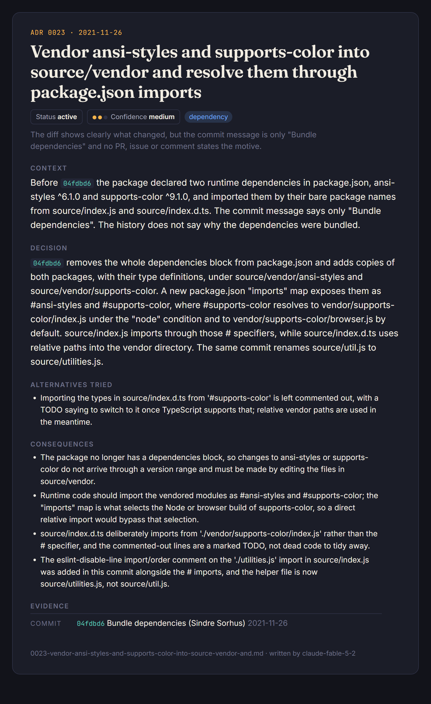

<p align="center">
  
</p>

# backstory

**Recover the why behind your code.**

Backstory mines git history, PR descriptions, issues, code comments and reverts to rebuild the decisions behind the code you have today: why this dependency, why this workaround, what was tried and rolled back. The output is a decision log you can browse, with every entry linked to the commits and PRs behind it.

<p align="center">
  <a href="media/tutorial.mp4"></a>
  <br>
  <sub>Preview of the 75-second tutorial. Full video: <a href="media/tutorial.mp4">media/tutorial.mp4</a></sub>
</p>

## Why

Every codebase has a line like `await sleep(250); // do not remove`. `git blame` gives you a name and a date. The reason is somewhere else: a PR description, a revert two commits later, an issue someone linked once.

People leave, and that context leaves with them. Then a newcomer, or a coding agent, cleans up the "dead" line and brings back the outage it was written to stop.

The reasons are usually still in the repository's history. Backstory reads it and writes them down as architecture decision records (ADRs), so the next person or agent can check before changing something.

## How it works

<p align="center">
  
</p>

1. **Sources.** `git log` with per-file line counts, the PR and issue text behind those commits (through `gh api`), and comments in the current tree that explain themselves, traced to their commit with `git blame`.
2. **Signals.** Dependencies added, removed or swapped in a manifest. Reverts, matched to the commit they undo. Large or structural changes. Config and package-contract changes (`engines`, `type`, `exports`). Commit messages and comments that say "because", "workaround", "hack", "for now", "do not remove".
3. **Decisions.** Signals on linked commits are grouped into one candidate: a revert with the commit it reverted, commits merged through the same PR, a dependency that was added and then removed again within a few months. Candidates are ranked and the strongest are written up.
4. **Records.** Claude (`claude-fable-5-2` by default) writes each candidate as an ADR: context, decision, alternatives tried, consequences, evidence links and a confidence level. It is told to state a reason only when the evidence states it, and to write "the history does not say why" otherwise. It can also skip a candidate that is not a decision.

## Install

Requires Node.js 22 or later and git.

```bash
npm install -g github:hesselb20-ctrl/backstory
```

Or run it without installing:

```bash
npx github:hesselb20-ctrl/backstory scan .
```

Backstory is not on npm (the name `backstory` there belongs to an unrelated package), so install it from GitHub as shown.

To write the records, Backstory needs Claude through one of:

- `ANTHROPIC_API_KEY` in the environment (uses the Claude API), or
- a signed-in [Claude Code](https://claude.com/claude-code) install on your PATH (uses `claude -p` with tools switched off).

With neither, `scan` still runs and writes evidence-only records marked as low confidence.

PR and issue text is fetched with the [GitHub CLI](https://cli.github.com) when it is installed. Without it, Backstory falls back to the GitHub REST API, using `GITHUB_TOKEN` if set.

## Quickstart

```bash
backstory scan path/to/repo
```

```text
Reading history of chalk/chalk
  381 commits, 115 signals (45 config, 17 refactor, 29 dependency, 17 message, 2 revert, 5 comment)
  30 decision candidates
Writing records with claude-fable-5-2 (Claude Code CLI)
   3/30 Use supports-color instead of has-color for terminal color detection
   1/30 skipped: The commit only adds logo artwork ...
  ...
28 decisions written to path/to/repo/decisions
```

This writes to `<repo>/decisions`:

| File | What it is |
| --- | --- |
| `0001-….md` to `00NN-….md` | One ADR per decision, with YAML front matter |
| `index.json` | The same records as data, read by the viewer and the MCP server |
| `index.html` | The viewer: one self-contained file, no server, no network requests |

Open `decisions/index.html` in a browser, or ask from the terminal:

```bash
backstory why source/vendor
```

Useful options:

| Option | Effect |
| --- | --- |
| `--dry-run` | List the candidates and stop before any model call |
| `--max <n>` | Most candidates to write up (default 25) |
| `--since <date>` / `--max-commits <n>` | Limit how much history is read |
| `--out <dir>` | Write the log somewhere else |
| `--no-github` | Skip PR and issue text |
| `--provider api\|claude-cli\|none` | Choose how records are written |
| `--model <id>` | Use another Claude model |

Run `backstory --help` for the full list.

## Example output

[`examples/chalk`](examples/chalk) holds the result of running Backstory on [chalk/chalk](https://github.com/chalk/chalk) (MIT): 381 commits in, 28 decisions out. Start with [the index](examples/chalk/README.md), or download [`index.html`](examples/chalk/decisions/index.html) and open it.

<p align="center">
  
</p>

One record, as the viewer shows it:

<p align="center">
  
</p>

The same record as markdown: [0023-vendor-ansi-styles-and-supports-color…](examples/chalk/decisions/0023-vendor-ansi-styles-and-supports-color-into-source-vendor-and.md). A record built from a revert: [0010-revert-the-lint-fix…](examples/chalk/decisions/0010-revert-the-lint-fix-that-replaced-x-escapes-with-u-escapes-i.md).

Note what the records do not claim. chalk's commit messages are often two words long, so many records say "the history does not say why" and carry low or medium confidence. That is the intended behaviour: Backstory reports what the history supports.

## MCP setup

Backstory ships an MCP server with one tool, `why(target)`, so a coding agent can ask before it changes code. `target` is a file path, a folder, or a symbol name.

Claude Code:

```bash
claude mcp add backstory -- npx -y github:hesselb20-ctrl/backstory mcp --decisions ./decisions
```

Any MCP client (`.mcp.json`, Claude Desktop, Cursor and others):

```json
{
  "mcpServers": {
    "backstory": {
      "command": "npx",
      "args": ["-y", "github:hesselb20-ctrl/backstory", "mcp", "--decisions", "./decisions"]
    }
  }
}
```

The server reads `decisions/index.json` on every call, so a fresh scan is picked up without a restart. Paths match records that touch that file or folder. Symbols match records that discuss them, and records that touch the files where the symbol occurs (`--repo <dir>` sets the checkout to search, default `.`).

To make an agent use it, add a line to your `CLAUDE.md` or `AGENTS.md`:

```text
Before refactoring, deleting a workaround, swapping a dependency or changing config,
call backstory's why() on the files you will touch and respect what it returns.
```

An empty answer means no decision was recorded for that target. It does not mean the change is safe, and the tool says so in its reply.

## Tutorial video

The tutorial in [`media/tutorial.mp4`](media/tutorial.mp4) (75 s, 1920x1080, 30 fps, no audio) is code: a [Remotion](https://www.remotion.dev) project in [`tutorial/`](tutorial). The banner above is a still from the same project, and the viewer, the diagram and the video share one palette and type scale.

```bash
cd tutorial
npm install
npm run studio   # preview and edit
npm run render   # writes tutorial/out/tutorial.mp4
npm run hero     # writes media/hero.png
```

The other images are also made in code: `npm run diagram` writes the SVG, and `node scripts/screenshot.mjs` takes the two viewer screenshots with a local Chrome or Edge.

## Limitations

- **It reads history; it cannot recover what was never written.** A decision made in a meeting and committed as "fix" comes out as a low-confidence record of what changed.
- **Records are written by a model.** They are tied to evidence and carry a confidence level, but they can still be wrong. Treat them as a well-sourced draft and follow the links.
- **Detection is heuristic.** Thresholds and keyword lists decide what counts as a signal. Quiet but important decisions can be missed, and routine changes can be picked up (the model skips some of those).
- **Keywords are English.** Comments and commit messages in other languages are only caught by the structural signals.
- **GitHub only for PR and issue text.** GitLab, Bitbucket and others still get the git-based signals. Without `gh` or a token, GitHub allows 60 anonymous requests an hour per address. The chalk example was scanned that way and hit the limit, so only two PR descriptions were read; the other PRs are linked but their text was not used.
- **Squash merges hide intermediate steps.** What was tried inside a PR and dropped before merge is invisible unless the PR description mentions it.
- **Manifest parsing is deepest for `package.json`.** Other manifests (`requirements.txt`, `pyproject.toml`, `go.mod`, `Cargo.toml`, `Gemfile`, `pom.xml`, Gradle, Composer) use a simpler line diff.
- **Model calls cost money or quota.** One call per candidate. Use `--dry-run` and `--max` to see and limit that first.
- **Re-scans renumber.** IDs follow date order within one scan, so an ADR number is not stable across scans yet.

## Roadmap

- Incremental scans that keep ADR numbers stable and only write up new history
- GitLab and Bitbucket enrichment
- Review comments and linked discussions as evidence, not only PR descriptions
- Symbol-level blame, so `why(symbol)` can follow a function across renames
- A `backstory check` command for CI that flags a diff touching code with a recorded decision
- Structural parsing for more manifests
- A published npm package under a scoped name

## Development

```bash
npm install
npm run build
npm test
node dist/cli/index.js scan path/to/repo --dry-run
```

The scanner and viewer are in [`cli/`](cli), the MCP server in [`mcp/`](mcp), the video in [`tutorial/`](tutorial).

## License

[MIT](LICENSE). The example records in `examples/chalk` describe [chalk/chalk](https://github.com/chalk/chalk), which is MIT licensed by Sindre Sorhus; no chalk source code is included beyond short quoted fragments in the records.
