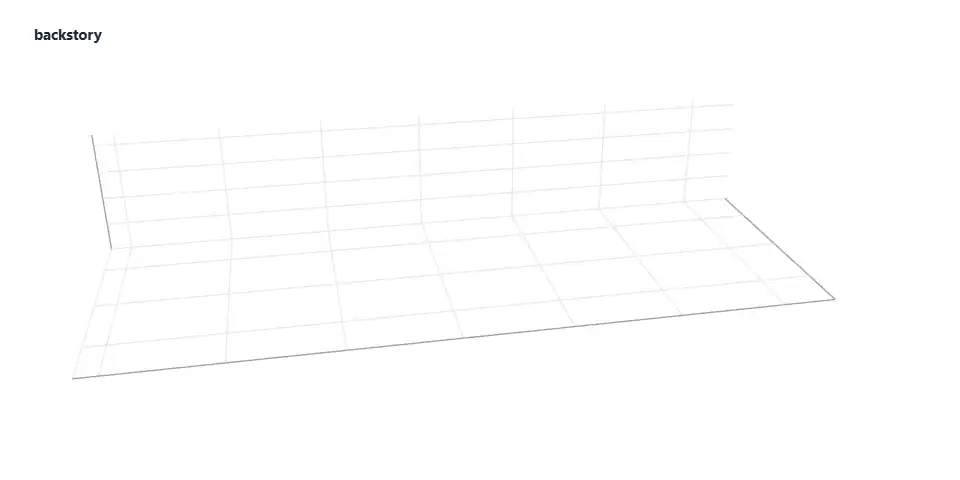

# Backstory

Rebuilds the decisions behind code from its git history.



<sub>From the example run on the chalk repository in `examples/chalk/decisions/index.json`. One run; the records were written by a model, and only 2 pull-request descriptions were read because of a rate limit.</sub>

## What it is

Backstory reads a repository's git history and finds the commits that look like decisions: a
dependency swapped, a change reverted, a large refactor, a config change, a comment that says
"workaround". It writes each one up as an architecture decision record (ADR) with links to the
commits and pull requests behind it. You can browse the records in a timeline, ask for them from the
terminal, or let a coding agent ask through MCP.

It is a prototype, version 0.1.0. It has been run with a model on one real repository, chalk. It has
no CI and is not published on npm.

## Why it exists

**The problem.** `git blame` tells you who wrote a line and when. It does not tell you why. The reason
sits in a PR description, a revert two commits later, or an issue someone linked once. When the
people who knew leave, a newcomer or a coding agent removes the "dead" workaround and brings back the
bug it was there to stop.

**What was missing.** The reasons are often still in the history, but nobody collects them. Backstory
collects them into one decision log per repository, and only states a reason when the evidence
states it. Otherwise the record says "the history does not say why".

**Who it is for.** Maintainers handing over a codebase, people joining one, and coding agents. The
MCP tool tells an agent to call it before refactoring, removing a workaround, swapping a dependency
or changing config (`mcp/server.ts`).

## How it works

1. **Read.** `git log --numstat -M` gives every commit, oldest first, with per-file line counts and
   renames resolved. `--since` and `--max-commits` limit how much is read.
2. **Comments.** `git grep` finds comments in the current tree with words like "because",
   "workaround", "do not remove" or "see #123". `git blame` traces each one to the commit that wrote it.
3. **Signals.** Each commit is checked for dependency changes in a manifest (`package.json` is parsed;
   other manifests get a line diff), reverts, large or structural changes, config and package-contract
   changes (`engines`, `type`, `exports` and others), and reason words in the message. Lock files,
   build output and `vendor/` folders are ignored.
4. **Group and rank.** Signals on linked commits become one candidate: a revert with the commit it
   undoes, commits merged through one PR, a dependency added and removed again within 120 days. A
   candidate gets a score from its signal weights. Weak ones are dropped, and the strongest 25 are kept
   by default (`--max`).
5. **GitHub text.** For a GitHub remote, PR and issue descriptions referenced by those commits are
   fetched with `gh api`, or the REST API (with `GITHUB_TOKEN` if set) when `gh` is not installed. At
   most 60 requests by default (`--github-budget`), cached in the system temp folder.
6. **Draft.** One model call per candidate writes the record: context, decision, alternatives tried,
   consequences, status and a confidence level. The prompt allows a reason only when the evidence
   gives one, and lets the model skip a candidate that is not a decision. With `--provider none` the
   record lists what the detector found and is marked low confidence.
7. **Write.** The output folder gets `NNNN-title.md` files, `index.json`, and `index.html`, a viewer in
   one file with the data inside it. A re-scan deletes the existing `NNNN-*.md` files in that folder
   before writing new ones, and the numbers can change.
8. **Ask.** `backstory why <target>` and the MCP tool `why` match a file, folder or symbol against
   `index.json`. No model is called.

## Capabilities

What the code does today.

- **History reader.** Commits, per-file line counts, renames, patch excerpts. `cli/git.ts`
- **Signal detection.** Dependency, revert, refactor, config, message and comment signals. `cli/signals.ts`
- **Grouping and ranking.** Union of linked commits, capped at 6 commits per candidate. `cli/group.ts`
- **GitHub enrichment.** PR and issue text through `gh api` or REST, with a request budget and a
  rate-limit stop. `cli/github.ts`
- **Record writer.** Three providers: the Claude API (`@anthropic-ai/sdk`), a signed-in Claude Code
  run as `claude -p` with tools off, or `none`. The default picks the API when `ANTHROPIC_API_KEY` is
  set, then Claude Code, then `none`. Default model id `claude-fable-5-2`. `cli/writer.ts`
- **ADR output.** Markdown with YAML front matter and an evidence list. `cli/adr.ts`
- **Viewer.** One HTML file with search, a file filter, area and signal filters and a timeline. `cli/viewer.ts`
- **Lookup.** `why` for paths and symbols, with an explicit "nothing recorded" answer. `cli/why.ts`
- **MCP server.** stdio, one read-only tool `why(target, limit)`, reads `index.json` on every call. `mcp/server.ts`
- **Example.** 28 records from a model run on [chalk/chalk](https://github.com/chalk/chalk). `examples/chalk`

Known limits:

- It can only find what was written down. A decision made in a meeting and committed as "fix" becomes
  a low-confidence record of what changed.
- Records are written by a model. They link to their evidence and carry a confidence level, but they
  can be wrong.
- Detection is heuristic: thresholds and English keyword lists. Quiet decisions can be missed.
- PR and issue text comes from GitHub only. Without `gh` or a token GitHub allows 60 anonymous
  requests an hour. The chalk example hit that limit, so only 2 PR descriptions were read
  ([`examples/chalk/README.md`](examples/chalk/README.md)).
- A folder lookup matches only files a record lists. Vendored and build folders are never listed, so
  `why source/vendor` on the chalk example returns weak same-folder matches, not ADR 0023.
- ADR numbers follow date order within one scan and are not stable across scans.
- With a model provider, every candidate costs one call. `--dry-run` shows the candidates first.

## Quick start

Requires Node.js 22 or newer and git. Commands below were run on Windows 11 with Node 26.13.0,
npm 11.20.0 and git 2.53.0.

```bash
git clone https://github.com/hesselb20-ctrl/backstory.git
cd backstory
npm ci
npm run build
```

Run the tests. Expect `pass 9`, `fail 0`.

```bash
npm test
```

List the decision candidates in this repository without calling a model or GitHub. On this
repository's 8 commits that printed `14 signals` and `5 decision candidates`.

```bash
node dist/cli/index.js scan . --dry-run --no-github
```

Write an evidence-only log, with no model. Point `--out` at a folder of its own: a scan deletes
existing `NNNN-*.md` files there. This wrote 5 records, `index.json` and `index.html`.

```bash
node dist/cli/index.js scan . --provider none --no-github --out ../backstory-log
```

Ask the committed chalk log about a file. This printed `5 decisions behind "source/index.js"`, led by
ADR 0025, matched through a comment at `source/index.js:247`.

```bash
node dist/cli/index.js why source/index.js --decisions examples/chalk/decisions
```

`node dist/cli/index.js mcp --decisions examples/chalk/decisions` starts the MCP server on stdio. Here
an MCP client listed one tool, `why`, marked read-only, and got the same records back.

Not run here: a scan with a model (`--provider api` needs `ANTHROPIC_API_KEY`; `claude-cli` needs a
signed-in Claude Code), GitHub enrichment, `npm install -g github:hesselb20-ctrl/backstory`, and
registering the server in an MCP client such as Claude Code. Run `node dist/cli/index.js --help` for
every option.

## Stack, status, roadmap

**Stack**

| Layer | Built with |
|---|---|
| CLI | TypeScript, Node.js 22+, `node:util` parseArgs, git |
| Records | `@anthropic-ai/sdk`, or the Claude Code CLI |
| GitHub text | `gh` CLI or the REST API via `fetch` |
| MCP server | `@modelcontextprotocol/sdk`, `zod`, stdio |
| Viewer | One HTML file, inline CSS and JavaScript |
| Tests | `node:test`, 9 unit tests |
| Tutorial video | Remotion, separate project in [`tutorial/`](tutorial) |

**Status**

| Part | State |
|---|---|
| Scan, signals, grouping | Built. Tested by unit tests and the runs above. |
| Model-written records | Run once, on chalk (381 commits, 28 records), per [`examples/chalk/README.md`](examples/chalk/README.md). Not run here. |
| GitHub enrichment | Used in the chalk run, cut short by the rate limit. Not run here. |
| `why` and MCP server | Run here against the chalk log. Not tested inside a real agent session. |
| Distribution | Not on npm. The npm name `backstory` belongs to another package. |
| CI | None. |

**Roadmap.** As listed in the repository's previous README:

1. Incremental scans that keep ADR numbers stable and only write up new history.
2. GitLab and Bitbucket enrichment.
3. Review comments and linked discussions as evidence, not only PR descriptions.
4. Symbol-level blame, so `why(symbol)` can follow a function across renames.
5. A `backstory check` command for CI that flags a diff touching code with a recorded decision.
6. Structural parsing for more manifests.
7. A published npm package under a scoped name.

**Documents**

| File | Contents |
|---|---|
| [`examples/chalk/README.md`](examples/chalk/README.md) | The chalk run: command, counts, table of all 28 records |
| [`examples/chalk/decisions/index.html`](examples/chalk/decisions/index.html) | The viewer for that run; download and open it |
| [`media/tutorial.mp4`](media/tutorial.mp4?raw=true) | 75-second tutorial video, no sound, 1920x1080, 3.3 MB download |

## License

MIT. See [`LICENSE`](LICENSE).

The records in `examples/chalk` describe [chalk/chalk](https://github.com/chalk/chalk), which is MIT
licensed by Sindre Sorhus. No chalk source code is included beyond short quoted fragments in the
records.
